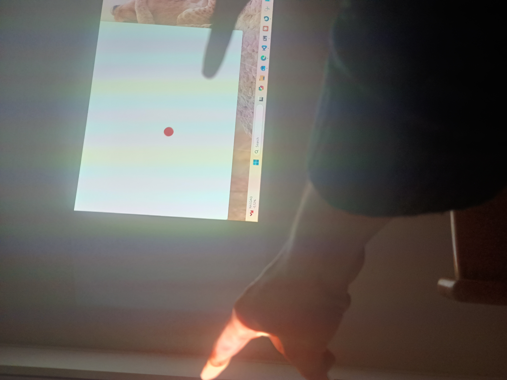

# CAM_pygame

Interactivity with games through a camera + projector setup.



## Setup

You need a projector or beamer and a USB camera pointed at the projected screen. The default display target is screen 2 (`TARGET_DISPLAY_INDEX = 1` in the level scripts).

On this Windows setup, OpenCV camera index `1` is used for the secondary webcam in the updated levels.


## Install

```powershell
.\.w_venv\Scripts\python.exe -m pip install -r requirements.txt
```

## Games

Root scripts:

- `level_1.py` - Dock level with shadow-driven waves and a boat.
- `level_2.py` - Gravity well with warped background and flying objects.
- `level_3.py` - Single-player heat glider with keyboard controls.
- `level_4.py` - Multiplayer heat gliders with QR phone controllers.
- `level_4_bis.py` - Multiplayer wraparound heat gliders with floor gaps and throwable stones.
- `main_levels.py` - Runs Level 1, then Level 2 after success.

Experimental scripts live in `experiments/`.

## Run

Level 1:

```powershell
.\.w_venv\Scripts\python.exe .\level_1.py --camera-index 1
```

Level 2:

```powershell
.\.w_venv\Scripts\python.exe .\level_2.py --image images\galaxy-1489300667bhk.jpg --camera-index 1
```

Level 3:

```powershell
.\.w_venv\Scripts\python.exe .\level_3.py
```

Level 4:

```powershell
.\.w_venv\Scripts\python.exe .\level_4.py
```

Level 4 Bis:

```powershell
.\.w_venv\Scripts\python.exe .\level_4_bis.py --camera-index 1
```

Combined Level 1 -> Level 2 flow:

```powershell
.\.w_venv\Scripts\python.exe .\main_levels.py --image images\galaxy-1489300667bhk.jpg --camera-index 1
```

## Camera Selection

`level_1.py`, `level_2.py`, `level_4_bis.py`, and `main_levels.py` support:

```powershell
--camera-index 1
```

Use `--camera-index 0` if you want the primary webcam instead.

## Phone Controllers

`level_4.py` and `level_4_bis.py` start a local setup page and QR controller page. Phones must be on the same Wi-Fi network as the computer.

Useful options:

```powershell
--public-host 192.168.x.x
--http-port 8000
--ws-port 8765
```

Use `--public-host` if auto-detection prints `127.0.0.1` or phones cannot connect.

## Calibration Cache

Level scripts support `--cached-calibration`.

- Without it, the script runs camera/projector calibration and writes `calibration_cache.npz`.
- With it, the script loads `calibration_cache.npz` and skips calibration.

